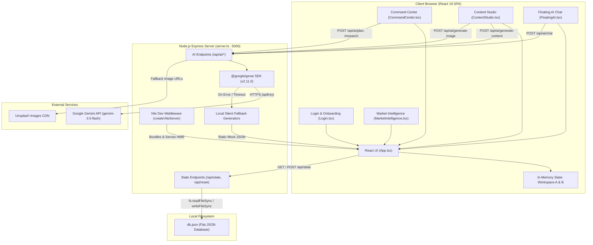

# SWAPNO AI — EXISTING ARCHITECTURE
**Document ID:** `02-EXISTING-ARCHITECTURE`  
**Phase:** Foundation Sprint (Phases 1 & 2)  
**Date:** November 2026  
**Auditor:** Senior SaaS Software Architect  
**Status:** Verified Against Codebase  

---

## 1. Existing System Architecture Map

The existing prototype is structured as a single monorepo running on Node.js. An Express server serves both JSON API endpoints and Vite development middleware from a single entry point (`server.ts`).



---

## 2. Frontend Architecture Map

### 2.1 Technology Stack
- **Framework:** React 19.0.1
- **Bundler / Tooling:** Vite 6.2.3, TypeScript 5.8.2
- **Styling:** Tailwind CSS 4.1.14 with `@tailwindcss/vite` plugin
- **Icons:** `lucide-react` 0.546.0
- **Animations:** `motion` 12.23.24
- **Typography:** Inter (Sans), Space Grotesk (Display), JetBrains Mono (Code/Mono) loaded via Google Fonts in `src/index.css`

### 2.2 Component Hierarchy & Data Flow
```
src/
├── main.tsx                    # React DOM root render
├── index.css                   # Tailwind 4 theme & Google Fonts import
├── types.ts                    # Global TypeScript interfaces
├── App.tsx                     # Top-level state container, navigation, layouts
├── data/
│   └── workspaceData.ts        # Hardcoded initial states for Workspace A & B
└── components/
    ├── Login.tsx               # Landing, login form, and onboarding wizard
    ├── CommandCenter.tsx       # Focus mode, health score, 27-step checklist
    ├── ContentStudio.tsx       # Calendar grid, post cards, editing modal
    ├── FloatingAI.tsx          # Floating multi-agent contextual chat drawer
    └── MarketIntelligence.tsx  # 4-quadrant market insight cards
```

### 2.3 State Management Pattern
State is managed monolithically in `src/App.tsx`:
```typescript
const [currentWorkspace, setCurrentWorkspace] = useState<'A' | 'B'>('A');
const [workspaceA, setWorkspaceA] = useState<SwapnoAppState>(workspaceAData);
const [workspaceB, setWorkspaceB] = useState<SwapnoAppState>(workspaceBData);
```
- **Read Flow:** On initial render, `App.tsx` issues `fetch('/api/state')`. If successful, it overrides `workspaceA` with server state.
- **Write Flow:** Any modification to Workspace A triggers `saveStateToServer(nextState)`, sending an HTTP `POST /api/state` with the entire serialized state.
- **Workspace B Isolation:** Workspace B exists only in client memory. It is never persisted to the server.

---

## 3. Backend Architecture Map

### 3.1 Technology Stack
- **Runtime:** Node.js (CommonJS build via esbuild or direct `tsx` execution)
- **HTTP Server:** Express 4.21.2
- **AI SDK:** `@google/genai` 2.11.0
- **Environment Management:** `dotenv` 17.2.3

### 3.2 Endpoint Inventory & Behaviors

| Route | Method | Payload | Target Action | Fallback Behavior |
|---|---|---|---|---|
| `/api/state` | `GET` | None | Reads `db.json` via `fs.readFileSync` and returns JSON. | Returns `defaultState` if file does not exist or fails parsing. |
| `/api/state` | `POST` | `SwapnoAppState` | Writes entire payload to `db.json` via `fs.writeFileSync`. | Logs error to console if write fails. |
| `/api/reset` | `POST` | None | Overwrites `db.json` with initial hardcoded `defaultState`. | Returns `defaultState` in response. |
| `/api/ai/chat` | `POST` | `{ agentName, message, state }` | Calls Gemini for structured memo with reply, reasoning, confidence, and impact. | Returns canned strategic response matching `agentName` after 1200ms. |
| `/api/ai/brainstorm` | `POST` | `{ businessSetup }` | Calls Gemini to produce elevator pitch, value prop, competitors. | Returns hardcoded generic pitch after 1500ms. |
| `/api/ai/research` | `POST` | `{ businessSetup, businessBrain }` | Calls Gemini to generate market overview, competitors, hashtags, personas. | Returns hardcoded Alex Rivera & Emily Vance personas after 1500ms. |
| `/api/ai/strategy` | `POST` | `{ businessSetup, research }` | Calls Gemini to generate 3 channels, 4 pillars, 2 campaign themes. | Returns hardcoded B2B LinkedIn/Twitter strategy after 1500ms. |
| `/api/ai/plan` | `POST` | `{ businessSetup, strategy }` | Calls Gemini to generate 4 planned social posts with image prompts. | Generates 4 hardcoded fallback posts with incremented future dates. |
| `/api/ai/generate-content` | `POST` | `{ businessSetup, item }` | Calls Gemini to generate platform-specific copy (LinkedIn, Twitter, Instagram). | Returns pre-written template copy based on platform string. |
| `/api/ai/generate-image` | `POST` | `{ prompt }` | Attempts `gemini-3.1-flash-lite-image` model call. | Keyword-matches prompt to curated Unsplash CDN URLs. |

---

## 4. Data Persistence Architecture (`db.json`)

The entire system persistence layer consists of a single 256-line JSON file (`db.json`) located at the project root.

### Structure of `db.json`
```json
{
  "businessSetup": {
    "name": "NiRBAAN Design Studio",
    "industry": "Interior Design",
    "targetAudience": "Luxury Homeowners",
    "description": "...",
    "tone": "Professional, Luxury, Minimal",
    "colors": ["#171717", "#5c6f59", "#dfd7ca"],
    "keywords": ["SustainableLuxury", "MinimalistInterior", "..."]
  },
  "businessBrain": {
    "elevatorPitch": "...",
    "valueProposition": "...",
    "competitorList": ["..."],
    "synced": true
  },
  "research": { ... },
  "strategy": { ... },
  "contentPlan": [ ... ],
  "analytics": [ ... ],
  "memoryLogs": [ ... ],
  "currentStep": "setup"
}
```

### Architectural Limitations
1. **Single Record:** The file stores only one active state. There is no concept of a collection of users or a collection of workspaces.
2. **Race Conditions:** Node's event loop executes I/O asynchronously, but `fs.readFileSync` and `fs.writeFileSync` are synchronous and non-atomic. Two simultaneous writes will overwrite each other with the slower request winning.
3. **Memory Footprint:** As content plans and memory logs accumulate, the entire database must be read into memory, parsed, serialized, and written to disk on every single change.

---

## 5. AI Integration & Fallback Mechanism

### 5.1 Model Calling Pattern
The server instantiates `@google/genai` using:
```typescript
ai = new GoogleGenAI({
  apiKey: apiKey,
  httpOptions: { headers: { 'User-Agent': 'aistudio-build' } }
});
```
Every endpoint configures structured output using `responseMimeType: "application/json"` and `responseSchema: { type: Type.OBJECT, properties: ... }`.

### 5.2 The Silent Fallback Vulnerability
Every AI endpoint wraps the Gemini SDK call in a `try...catch` block. When an error occurs (such as invalid API key, quota limit, network timeout, or unrecognized model name `"gemini-3.5-flash"`):
```typescript
try {
  const response = await ai.models.generateContent({ ... });
  res.json(JSON.parse(response.text.trim()));
} catch (err) {
  console.log("Triggered local fallback flow...");
  fallback(); // Returns hardcoded pre-written mock JSON
}
```
**Why this is dangerous in production:**
- The client receives HTTP 200 OK with formatted JSON.
- The user has no way of knowing whether the output was intelligently synthesized from their business profile or retrieved from a hardcoded template written by the prototype developer.
- If a user inputs a dental clinic, the fallback might return SaaS copywriting or restaurant pasta copy!

---

## 6. Environment & Heritage Analysis

### 6.1 Artifacts of Google AI Studio
- `.env.example`:
  ```bash
  # AI Studio automatically injects this at runtime from user secrets.
  GEMINI_API_KEY=YOUR_GEMINI_API_KEY
  APP_URL=http://localhost:3000
  ```
- `metadata.json`:
  ```json
  {
    "name": "Swapno AI",
    "description": "An AI Marketing Operating System...",
    "requestFramePermissions": [],
    "majorCapabilities": ["MAJOR_CAPABILITY_SERVER_SIDE_GEMINI_API"]
  }
  ```
- `index.html`:
  `<title>My Google AI Studio App</title>`
- `package.json`:
  `"name": "react-example"`

These artifacts demonstrate that the repository originated as a Cloud Run / AI Studio web container prototype. While suitable for rapid proof-of-concept testing, none of the standard SaaS infrastructure (reverse proxy, database connection pools, authentication headers, worker queues, telemetry) has yet been introduced.
