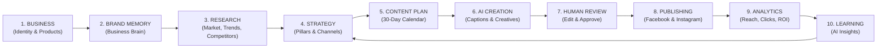
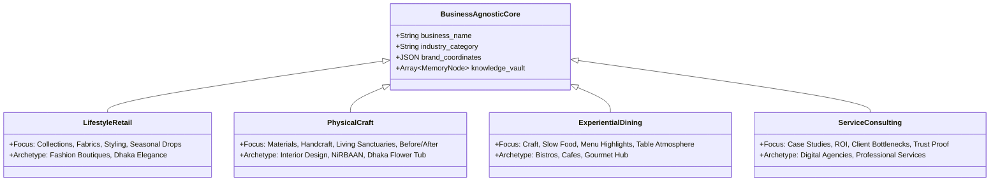

# SWAPNO AI — PRODUCT BLUEPRINT
**Document ID:** `03-PRODUCT-BLUEPRINT`  
**Phase:** Foundation Sprint (Phases 1 & 2)  
**Date:** November 2026  
**Auditor / Product Architect:** Senior SaaS Product Architect  
**Status:** Approved Blueprint Specification  

---

## 1. Product Identity and Core Promise

### 1.1 Brand Foundations
- **Product Name:** SWAPNO AI (স্বপ্ন এআই)
- **Tagline:** Your Marketing Adviser
- **Positioning Statement:** The Business Growth Operating System for independent businesses. Tell Swapno AI about your business once; it plans, creates, schedules, publishes, and improves your marketing every month.

### 1.2 The Core Problem Solved
Small business owners manage marketing across a fragmented, exhausting chain of disconnected tools:
$$\text{ChatGPT} \longrightarrow \text{Canva} \longrightarrow \text{Google Search} \longrightarrow \text{Meta Business Suite} \longrightarrow \text{Google Sheets} \longrightarrow \text{Notes}$$

Every time they use an AI tool, they must repeatedly explain:
- Who their customer is
- What products they sell and their pricing
- What their brand tone is
- What competitors are doing
- What worked last week

**SWAPNO AI compresses this entire chain into a single, cohesive operating loop.**

### 1.3 The Core Closed-Loop Engine

---

## 2. Target Market and Customer Profiles

### 2.1 Geographic Phasing
1. **Primary Launch Market:** Bangladesh (Dhaka, Chittagong, Sylhet metro areas).
2. **Expansion Market:** South Asia and emerging markets with high SME Facebook/Instagram commercial dependence.
3. **Global SaaS Market:** Independent international creators and boutique agencies.

### 2.2 Target Business Categories
SWAPNO AI is strictly business-agnostic. Its UI remains uniform while its domain intelligence adapts dynamically across four archetypes:

---

## 3. Commercial Model & Pricing Structure

### 3.1 Subscription Plans (Bangladesh Market First)

| Tier | Monthly Price | Target Customer | Core Entitlements | AI Quotas |
|---|---|---|---|---|
| **Starter** | **৳999** / mo | Micro-shops, solo boutiques, local salons | 1 Brand Workspace, Facebook + Instagram, 15 posts/mo, basic calendar, manual approval | 30 AI caption drafts, 15 image prompts |
| **Growth** *(Hero Plan)* | **৳1,999** / mo | Serious SMEs, restaurants, interior firms | 1 Brand Workspace, Facebook + Instagram, 30 posts/mo, full AI strategy, scheduling, auto-publish, weekly AI reports | 90 AI caption drafts, 30 bespoke image gens |
| **Professional** | **৳3,999** / mo | Fast-growing brands, multi-location stores | Up to 3 Brands, advanced competitor tracking, multi-team roles (Owner + Editor), priority queue | 250 AI caption drafts, 90 bespoke image gens |
| **Agency** | **৳7,999+** / mo | Digital marketing agencies, boutique studios | 5–10 Brands, client approval portal, white-label PDF dossiers, shared brand memory pools | 1,000+ AI caption drafts, custom image quotas |

### 3.2 High-Margin Setup Service
For Bangladeshi businesses hesitant to learn software independently:
- **SWAPNO Concierge Onboarding:** **৳2,000 – ৳5,000** (one-time fee).
- **Deliverables:** A human marketing specialist configures their Business Brain, imports their logo/assets, connects Meta OAuth, calibrates tone of voice, and generates their first 30-day content calendar.
- **Value:** Generates immediate upfront cash flow while securing high-retention monthly recurring subscriptions.

---

## 4. Phased Product Scope: MVP to Scale

### 4.1 Phase 1 (v1) — The Sellable MVP
**Mandate: Freeze scope to the minimum closed loop required to start onboarding paying customers.**
- Secure User Authentication (Email/Password & Google Login)
- Multi-Tenant Workspace & Brand Profile setup
- Ontological Business Brain with Knowledge Vault rules
- Facebook & Instagram official Meta OAuth connection
- AI Strategy Generator (Marketing Channels, 4 Content Pillars, Campaign Themes)
- 30-Day Monthly Content Calendar
- AI Copywriting (Platform-tailored for LinkedIn, FB, IG, Twitter)
- Creative Studio with image upload and AI visual generation
- Human-in-the-loop Editing & Approval workflow
- Scheduled background publishing worker
- Basic organic analytics dashboard (Reach, Clicks, Engagement)

### 4.2 Phase 1.5 — Retention & Stickiness
- Automated Weekly AI Performance Reports delivered via email
- Post regeneration and multi-version history tracking
- Real-time Meta webhook alerts for failed publications
- One-click PDF Executive Dossier export

### 4.3 Phase 2 — Market Differentiation
- Live Competitor Intelligence via web search grounding
- Multilingual content engine (Bangla, English, Banglish)
- WhatsApp Business notification alerts
- Direct Canva Connect SDK / Design editor embedding

### 4.4 Phase 3 — Scale & Expansion
- LinkedIn, TikTok, YouTube, and X official API adapters
- Short-form AI Video script and storyboard generator
- Multi-brand Agency Dashboard with client approval links
- Public REST API and webhook integrations

---

## 5. Explicit Anti-Features & Non-Goals for v1

To prevent project bloat, technical debt, and delayed launch, the following features are **explicitly banned from v1**:
1. **NO Full CRM Suite:** Do not build contact lists, deal stages, or sales pipelines.
2. **NO Email Marketing Automation:** Do not integrate Mailchimp or build newsletter campaign builders.
3. **NO Ad Spend Management:** Do not execute paid Meta Ads campaigns or manage credit cards for ad budgets.
4. **NO Video File Rendering:** Do not integrate expensive, slow AI video generation APIs (e.g. Runway, Sora). Limit video support to scripts, hooks, and storyboards.
5. **NO E-Commerce Inventory Sync:** Do not attempt two-way Shopify or WooCommerce product catalog syncing.
6. **NO Uncontrolled Autonomous Publishing:** Never allow the AI to publish content without explicit human review and approval settings.
