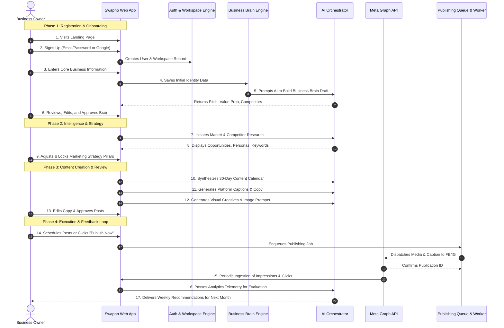

# SWAPNO AI — CUSTOMER JOURNEY
**Document ID:** `04-CUSTOMER-JOURNEY`  
**Phase:** Foundation Sprint (Phases 1 & 2)  
**Date:** November 2026  
**Auditor / Product Architect:** Senior SaaS Product Architect & UX Designer  
**Status:** Approved Customer Journey Specification  

---

## 1. Complete 17-Step SaaS Customer Journey

The complete customer journey transitions a business owner from initial curiosity to autonomous, measurable marketing growth.

---

## 2. Detailed Step-by-Step Screen Specification

### Step 1: Landing Page
- **Screen:** Public Landing Page (`/`).
- **User Action:** Explores 10-second value proposition, views interactive feature demo, clicks **"Get Started Free"** or **"Launch Onboarding Deck"**.
- **Data Displayed:** Hero banner, bento grid of core capabilities, customer testimonials, pricing table (৳999, ৳1,999, ৳3,999).
- **Validation:** None.

### Step 2: User Registration & Authentication
- **Screen:** Signup Screen (`/signup`).
- **User Action:** Enters Email, Full Name, Password (minimum 8 characters), or clicks **"Continue with Google"**.
- **System Trigger:** Creates row in `users` table; issues secure JWT session in HTTP-only cookie.
- **Validation:** Email format, password complexity, duplicate email detection.
- **Error States:** "Email already registered", "Password too weak", "Network timeout".

### Step 3: Workspace & Business Creation
- **Screen:** Workspace Initialization Wizard (`/onboarding/workspace`).
- **User Action:** Enters Business Name (e.g. "NiRBAAN Design Studio"), selects Industry Category from smart dropdown, enters Location (e.g. "Dhaka, Bangladesh").
- **System Trigger:** Creates row in `workspaces` and `brands` table; assigns current user as `owner`.
- **Validation:** Business name required, industry required.

### Step 4: Guided Business Onboarding (Progressive Disclosure)
- **Screen:** 3-Minute Guided Wizard (`/onboarding/identity`).
- **Inputs:**
  1. Products / Services offered (tag input or bullet list).
  2. Target Customer description (who buys, who can afford).
  3. Brand Tone of Voice (slider: Casual $\leftrightarrow$ Formal, Vibrant $\leftrightarrow$ Minimal).
  4. Brand Colors (HEX color picker) and optional Logo upload.
  5. Website and Social Media links (Facebook Page, Instagram handle).
- **UX Controls:** Progress indicator (Step 1 of 4), "Save & Continue", "Skip for now" options.
- **Data State:** Autosaves to `brands` and `business_brain_nodes` after each step.

### Step 5: Initial Business Brain Construction
- **Screen:** Brain Generation Loading State with transparent step progress.
- **AI Execution:** Central AI Orchestrator calls Brand Intelligence Agent with raw inputs.
- **Outputs Produced:**
  - Concise Elevator Pitch (1–2 sentences)
  - Core Value Proposition
  - 3–4 Identified Competitors (marked as *AI Suggested*)
  - 2 Buyer Persona Archetypes
- **Loading UX:** Animated status indicators ("Synthesizing brand DNA...", "Analyzing buyer personas...", "Structuring memory vaults...").

### Step 6: Review & Approval of Business Brain
- **Screen:** Business Brain Dashboard (`/brain`).
- **User Action:** Reviews AI suggestions. The owner can edit text inline, delete suggested competitors, or add specific negative rules ("Never use the word discount").
- **Decision Gate:** User clicks **"Approve Brand Brain"**.
- **System Trigger:** Marks `brain_approved = true`. Brain status changes from *Draft* to *Verified*.

### Step 7: Market & Competitor Intelligence Scan
- **Screen:** Intelligence Hub (`/intelligence`).
- **AI Execution:** Research Agent analyzes industry category, target audience, and approved competitors. Where enabled, uses live web grounding for active social search trends.
- **Outputs Produced:**
  - Market Overview: Current shifts in buyer expectations.
  - Competitor Radar: Content patterns observed in the sector.
  - 5 High-Momentum Search Hashtags.

### Step 8: Recommendation of Growth Opportunities
- **Screen:** Intelligence Action Card.
- **AI Output:** Translates research into actionable decisions: "Competitors in Dhaka are heavily using before/after reels. We recommend 2 project walk-throughs per week."
- **User Action:** Clicks **"Apply Recommendations to Strategy"**.

### Step 9: Marketing Strategy Formulation & Approval
- **Screen:** Strategy Studio (`/strategy`).
- **AI Execution:** Strategy Agent synthesizes marketing channels, 4 Content Pillars, and 2 Monthly Campaign Themes.
- **User Action:** Can re-order pillars, modify channel posting frequencies, or edit campaign themes.
- **Decision Gate:** User clicks **"Lock Monthly Strategy"**.

### Step 10: 30-Day Campaign & Calendar Synthesis
- **Screen:** Publishing Hub — Calendar View (`/publishing/calendar`).
- **AI Execution:** Content Agent generates a structured 30-day schedule (e.g. 15 to 30 posts depending on plan).
- **Data Grid:** Each day card displays Scheduled Date, Channel badge, Content Pillar, Post Title, and Status badge (*Draft*).

### Step 11: Platform-Specific Content Generation
- **Screen:** Content Studio Workspace Modal.
- **AI Execution:** Copywriting Specialist crafts ready-to-publish copy adapted specifically to the platform (LinkedIn: structured with line breaks and thought leadership CTA; Instagram: conversational with emojis and 5 hashtags; Facebook: community/engagement focus).
- **Validation:** Word count and character limits enforced per platform.

### Step 12: Creative Production & Asset Preparation
- **Screen:** Creative Studio Asset Drawer.
- **AI Execution:**
  - AI writes a detailed, photography-grade visual prompt.
  - Generates bespoke visual via image generation API, OR pulls user-uploaded brand logo/product image from the Brand Asset Library.
- **Asset Preservation Rule:** If a user specifies an authentic product photo, the AI does not alter the product shape or logo.

### Step 13: Content Review, Inline Editing, and Approval
- **Screen:** Post Review Modal with multi-platform live preview cards.
- **User Action:**
  - Edits caption text inline.
  - Changes scheduled date/time.
  - Toggles status to **"Approved"** (or clicks "Bulk Sign-off" for all draft posts).
- **System State:** Post status updates to `approved`.

### Step 14: Automated Scheduling and Live Publication
- **Screen:** Automation Hub & Calendar.
- **Workflow:**
  - **Scheduled Flow:** System pushes post to Redis publishing queue. Background worker polls queue and publishes via Meta Graph API at the exact timestamp.
  - **Immediate Flow:** User clicks **"Publish Now"**. Backend dispatches immediately to Meta API.
- **Verification:** System checks Meta API HTTP 200 response and stores the remote `post_id`. Post status changes to `published`. Never show "published" without remote confirmation.

### Step 15: Telemetry Collection & Social Data Sync
- **Background Worker:** Cron worker queries Meta Graph API every 6 hours for post impressions, reach, reactions, comments, and link clicks.
- **Storage:** Appends telemetry records to `analytics_snapshots`.

### Step 16: AI Performance Analysis
- **Screen:** Growth & Analytics (`/analytics`).
- **AI Execution:** Growth Intelligence Agent audits recent post metrics against historical averages.
- **Output:** Translates raw numbers into insights: "Soft Minimalism posts achieved 2.4x higher click-through rates than promotional posts this week."

### Step 17: Closed-Loop Continuous Improvement
- **Screen:** Command Center AI Suggestions card.
- **System Action:** Feeds performance insights back into the Business Brain Knowledge Vault as learned rules.
- **Cycle Repeats:** Next month's strategy automatically biases toward top-performing pillars and formats.

---

## 3. Direct-Task Workflows (Fast-Track Bypass)

A busy business owner must not be forced to complete all 17 steps when they simply want to create one post. SWAPNO AI provides 3 direct-task shortcuts:

### Direct Workflow A: "Quick Post Generator"
1. User clicks **"Create Post"** from any screen.
2. Selects Target Platform (e.g. Instagram) and Post Type (e.g. Product Highlight).
3. Types a 1-sentence prompt: *"Announce our new dining menu this Friday."*
4. AI retrieves active Brand Brain context automatically and generates caption + image prompt in 5 seconds.
5. User reviews, edits, and clicks **"Schedule"** or **"Publish Now"**.

### Direct Workflow B: "Brainstorm 5 Campaign Ideas"
1. User clicks **"Brainstorm"** in Strategy Studio.
2. Types an objective: *"We need more corporate interior design leads for Q4."*
3. AI returns 5 structured campaign angles with hooks, target audience segments, and recommended platforms.
4. User clicks **"Add to Calendar"** on the ideas they like.

### Direct Workflow C: "Upload Product & Create Creative"
1. User uploads a new product photo (e.g. a handcrafted chair).
2. AI detects product category, references Brand Brain colors and guidelines, and drafts 3 carousel caption variants.
3. Post is immediately placed in the review queue.
