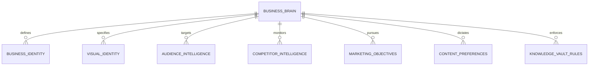
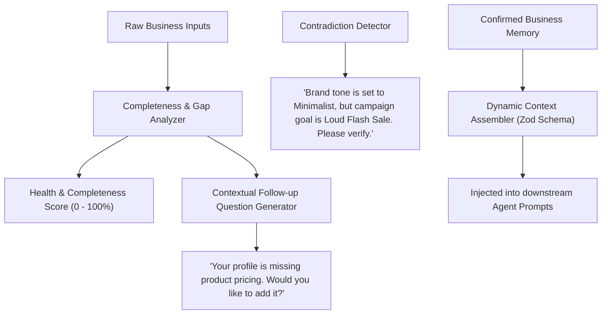

# SWAPNO AI — BUSINESS BRAIN SPECIFICATION
**Document ID:** `05-BUSINESS-BRAIN-SPECIFICATION`  
**Phase:** Foundation Sprint (Phases 1 & 2)  
**Date:** November 2026  
**Auditor / AI Architect:** Senior AI Systems & Knowledge Architect  
**Status:** Proposed Business Brain specification; the current local profile is partial and is not yet a production AI context service. See `docs/ARCHITECTURE.md`.

---

## 1. Role and Philosophy of Business Brain

The **Business Brain** is the central, permanent repository of brand intelligence and operational memory within SWAPNO AI. It acts as the single source of truth (SSOT) injected into every downstream AI agent (Strategy, Copywriting, Creative, Research, and QA).

### Core Architectural Principles
1. **Never Start from Scratch:** Every generation task retrieves the customer's verified brand memory, eliminating prompt repetition.
2. **Strict Verification Hierarchy:** Information is classified into two distinct states:
   - **CONFIRMED:** Explicitly entered or approved by the business owner.
   - **AI SUGGESTED:** Proposed by the AI; never treated as fact until approved.
3. **Preservation of Authentic Assets:** Original user-provided assets (logos, real product photos, founder images) are strictly protected by invariant rules that forbid generative hallucinations or destructive modifications.
4. **No Fabricated Facts:** The system strictly prohibits inventing product specifications, pricing, guarantees, customer reviews, or competitor data.

---

## 2. The 6-Dimensional Business Brain Ontology



### Dimension A: Business Identity
- **Business Name:** Official trading name.
- **Industry & Sub-Industry:** E.g., `Interior Design` $\rightarrow$ `Sustainable Biophilic Residential`.
- **Core Description:** Comprehensive narrative of the business, its history, and mission.
- **Products & Services Catalog:** Structured list with item name, category, key features, pricing tier, and unique benefits.
- **Geographic Service Area:** City, national, or international service scope (e.g. `Gulshan, Banani, Dhanmondi, Dhaka`).
- **Web & Social Touchpoints:** Website URL, Facebook Page URL, Instagram handle, LinkedIn profile.
- **Business Model:** B2C, B2B, D2C, Boutique Studio, or Franchise.
- **Unique Selling Proposition (USP):** What makes this business categorically different from all alternatives.

### Dimension B: Visual Identity & Asset Preservation Rules
- **Logo Assets:** Primary SVG/PNG vector logo, dark-mode variant, icon/mark.
- **Brand Color Palette:**
  - Primary Color (HEX string, e.g. `#171717`)
  - Secondary Accent Color (HEX string, e.g. `#E05822` / Orange)
  - Neutral Backgrounds (HEX strings, e.g. `#FBFBFA`, `#121212`)
- **Typography Guidelines:** Primary heading font (e.g. `Space Grotesk`), body font (e.g. `Inter`).
- **Visual Aesthetic Keywords:** Minimalist, warm architectural, organic textures, editorial lighting.
- **Strict Asset Preservation Rules (Invariants):**
  - *Logo Integrity:* Never regenerate, distort, re-color, or place fake text inside the official logo mark.
  - *Product Fidelity:* Never synthesize a fictional version of an existing physical product. If the business sells a specific timber table or clothing dress, the original photograph must be framed, not replaced with an AI hallucination.
  - *Prohibited Imagery:* E.g. "Never use neon graphics, clipart, cartoon vectors, or stock photos with artificial smiles."

### Dimension C: Audience Intelligence & Buyer Personas
- **Primary & Secondary Target Segments:** Demographics (age brackets, income levels, professional roles).
- **Psychographic Drivers:** Aspirations, aesthetic values, lifestyle status.
- **Core Pain Points:** What frustrates them about existing market options (e.g. cheap synthetic materials, poor communication).
- **Buying Triggers & Objections:** Price sensitivity, trust deficit, delivery concerns.
- **Structured Persona Profiles:**
  - *Persona 1:* E.g. "Farhan Ahmed (45) — Executive homeowner looking for quiet biophilic retreats in Dhaka."
  - *Persona 2:* E.g. "Nadia Rahman (38) — Wellness-focused architect seeking non-toxic, zero-VOC interiors."
- **Preferred Language & Nuance:** Standard English, Conversational Bangla, or Urban Banglish.

### Dimension D: Competitor Intelligence
- **Direct Competitors:** Immediate local businesses competing for the same customers.
- **Indirect Alternatives:** Do-it-yourself options, generic marketplaces, imported substitutes.
- **Aspirational / Inspiration Brands:** Global or regional leaders admired for aesthetics or marketing excellence.
- **Observed Competitor Strategies:** Noted weaknesses (e.g. "Competitors post low-quality phone photos without storytelling").
- **Verification Rule:** All AI-discovered competitors are flagged as `AI_SUGGESTED` until confirmed by the user.

### Dimension E: Marketing Objectives & KPIs
- **Primary Business Goals:** Brand Awareness, Inbound Lead Generation, Direct Online Sales, Foot Traffic, Community Growth.
- **Monthly Focus Objectives:** E.g. "Acquire 10 luxury duplex interior inquiries in November."
- **Monthly Marketing Budget:** Budget tier for organic content production and potential boosting.
- **Priority Products / Hero Offers:** Which 2–3 products or services should receive 70% of campaign visibility.

### Dimension F: Content Preferences & Tone Architecture
- **Voice & Tone Sliders:**
  - `Formal (1) <------------ [7] ------------> Casual (10)`
  - `Serious (1) <----------- [5] ------------> Playful (10)`
  - `Luxury/Minimal (1) <---- [2] ------------> Bold/Loud (10)`
- **Language Mode:**
  - `ENGLISH_ONLY`
  - `BANGLA_ONLY` (Formal or Conversational)
  - `BANGLISH` (Bangla written in English script or mixed natural urban dialect)
- **Content Format Preferences:** Reels/Short Video Scripts (40%), Carousel Deep Dives (35%), Single Image Posts (25%).
- **Publishing Frequency:** E.g., 4 posts per week (16 posts per month).
- **Prohibited Words & Forbidden Themes (Negative Prompting):**
  - E.g. "Never use words like *cheap*, *discount*, *budget*, *guaranteed*, or *miracle*."
  - E.g. "Never participate in political, religious, or controversial meme trends."

---

## 3. Business Brain Intelligence Engine

The Business Brain is not merely a passive database; it has an active intelligence layer that continuously evaluates and enriches brand memory:



### 3.1 Completeness Scoring Matrix (0 to 100%)
- **Identity Essentials (30%):** Name (+10%), Industry (+5%), Description (+10%), Location (+5%).
- **Visual DNA (20%):** Colors (+10%), Logo (+5%), Aesthetics keywords (+5%).
- **Audience & Personas (20%):** Target audience defined (+10%), at least 1 persona verified (+10%).
- **Strategy & Goals (15%):** Objectives selected (+10%), priority products listed (+5%).
- **Content Rules (15%):** Tone defined (+5%), language mode chosen (+5%), at least 1 negative rule (+5%).

### 3.2 Dynamic Context Assembler for LLM Prompts
When an AI agent is invoked, the Business Brain generates a compact, high-density system context snippet (under 400 tokens) formatted to avoid context clutter:

```
[SWAPNO BUSINESS BRAIN CONTEXT]
Brand: NiRBAAN Design Studio | Industry: Luxury Sustainable Interior Design | Dhaka, BD
USP: Merging international minimalist architecture with Bangladeshi craftsmanship & zero-VOC timbers.
Tone: Professional, Luxury, Understated | Language: English (clean, punchy spacing)
Personas: Farhan (45, Gulshan residential estate), Nadia (38, wellness-driven penthouse)
Active Content Pillars: Soft Minimalism, Sustainable Craftsmanship, Biophilic Sanctuaries
FORBIDDEN RULES: Never use words 'cheap', 'budget', 'discount'. Do not hallucinate timber species.
```

---

## 4. Progressive Onboarding UX Design

To prevent user drop-off, the Business Brain onboarding is designed around **progressive disclosure**:
1. **Initial Wizard (under 3 minutes):** Collects only 5 critical fields (Name, Category, 1-sentence description, Audience, Tone).
2. **Instant Gratification:** Immediately generates the initial Brain draft and sample post so the user sees value within 60 seconds.
3. **Background Enrichment:** Prompts for deeper details (Brand Assets, Personas, Competitor URLs) gradually via Command Center suggestions over the first 7 days.
4. **Permanent Autocommit:** Every keystroke autosaves to the backend with clear "Saved to Brain" micro-feedback.
