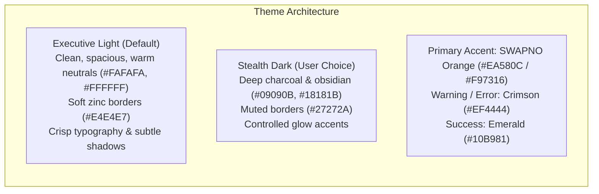
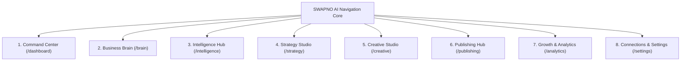

# SWAPNO AI — UX AND NAVIGATION ARCHITECTURE
**Document ID:** `06-UX-AND-NAVIGATION`  
**Phase:** Foundation Sprint (Phases 1 & 2)  
**Date:** November 2026  
**Auditor / UX Architect:** Senior SaaS Product Designer & UI Architect  
**Status:** Approved UX Specification  

---

## 1. Visual Direction & Theme Evolution

### 1.1 Critique of Existing UI
The existing prototype uses a **dense, terminal-style all-black dark interface** (`bg-black`, `bg-neutral-950`, neon orange accents, monospace badge overlays).
- **Strengths:** High visual impact, futuristic aesthetic, appealing to tech-savvy founders and software engineers.
- **Weaknesses:** Intimidating for traditional SME business owners (boutique managers, restaurant operators, salon owners); poor readability in daylight environments; creates cognitive friction.

### 1.2 Proposed Visual System: "Executive Warm Modern"
In alignment with the founder's vision, SWAPNO AI will support a **Theme-Adaptive System (Light by Default, Dark Mode, System Preference)**.

### 1.3 Design Standards & Foundations
- **Typography:**
  - *Headings & Display:* **Space Grotesk** (geometric, confident, modern).
  - *Body & UI:* **Inter** (clean, neutral, highly legible at small sizes).
  - *Data, Badges & Timestamps:* **JetBrains Mono** (precision telemetry feel).
- **Spacing Scale:** Standard 4px / 8px grid (`p-2`, `p-4`, `p-6`, `p-8`). Maximum content container width: 1440px.
- **Responsive Breakpoints:**
  - *Desktop (1200px+):* Full dual-pane view, expanded sidebar (w-64), visible calendar grid.
  - *Tablet (768px – 1199px):* Collapsed icon rail sidebar (w-16), 2-column bento grids.
  - *Mobile (375px – 767px):* Bottom navigation bar, single-column feed view, slide-up drawers for modals and AI chat.

---

## 2. Refined Application Navigation Structure

The navigation is streamlined from the prototype's loose 8 tabs into **7 core workflow modules plus a dedicated Settings/Connections area**:

---

## 3. Deep-Dive Specification for Every Module

### Module 1: Command Center (`/dashboard`)
- **Purpose:** Answers the user's primary daily question: *"What matters today and what should I do next?"* in under 10 seconds.
- **Main Screens:** Daily Overview, Priority Action Queue, Marketing Health Score indicator.
- **Main User Actions:**
  - Approve pending posts with 1 click.
  - Execute today's recommended action (e.g. "Draft Reel for Friday").
  - Review weekly growth performance.
- **Inputs:** Active workspace telemetry, pending post queue status.
- **Outputs:** Dynamic daily task list (3 priority cards maximum).
- **AI Involvement:** High; Growth Agent and QA Agent synthesize daily recommendations.
- **Empty State:** "Your marketing is completely up to date. Next scheduled release is tomorrow at 7:30 PM."
- **Loading State:** Skeleton cards shimmer with smooth pulse animation.
- **Permissions:** All workspace members (`owner`, `admin`, `editor`, `viewer`).

### Module 2: Business Brain (`/brain`)
- **Purpose:** Central management of business identity, visual DNA, audience personas, competitors, and knowledge rules.
- **Main Screens:** Identity Overview, Visual Asset Library, Personas & Audience, Competitor Radar, Knowledge Vault (negative rules & preferences).
- **Main User Actions:**
  - Edit business coordinates (description, tone, pricing).
  - Upload logos and brand photography.
  - Inject negative rules into the Knowledge Vault ("Never use the word cheap").
  - Confirm or reject AI-suggested competitors.
- **Inputs:** Form fields, image file uploads, text notes.
- **Outputs:** Verified brand memory records; compiled LLM context prompts.
- **AI Involvement:** Moderate; Brand Intelligence Agent parses uploaded documents and suggests missing fields.
- **Empty State:** Guided 3-minute Onboarding wizard triggers automatically.
- **Permissions:** `owner`, `admin` (editors have read-only access).

### Module 3: Intelligence Hub (`/intelligence`)
- **Purpose:** Real-time market research, competitor monitoring, search momentum, and social trends.
- **Main Screens:** Market Radar, Competitor Movements, Keyword Tracker, Trend Opportunites.
- **Main User Actions:**
  - Trigger live web research scan.
  - Add custom keyword or competitor URL to monitor.
  - Convert research insight into a campaign theme with 1 click.
- **Inputs:** Industry sector, geographic market, monitored URLs.
- **Outputs:** Structured research dossiers answering: *What Changed? Why It Matters? What Should I Do?*
- **AI Involvement:** Very High; Research Intelligence Agent executes web grounding queries.
- **Empty State:** "No competitor URLs added yet. Add your top 3 competitors to start receiving alerts."
- **Permissions:** All members.

### Module 4: Strategy Studio (`/strategy`)
- **Purpose:** Translates brand identity and market research into high-level marketing architectures and monthly campaign plans.
- **Main Screens:** Monthly Strategy Architect, Content Pillars, Campaign Themes, Channel Mix Allocation.
- **Main User Actions:**
  - Generate next month's strategic proposal.
  - Re-order or edit the 4 Content Pillars.
  - Adjust target channel frequencies (e.g. LinkedIn 2x/wk, Instagram 4x/wk).
  - Lock monthly strategy.
- **Inputs:** Business Brain memory, research opportunities, monthly objective.
- **Outputs:** Approved strategic brief; input parameters for Content Calendar generation.
- **AI Involvement:** Very High; Strategy Agent acts as Chief Marketing Officer (CMO).
- **Permissions:** `owner`, `admin`.

### Module 5: Creative Studio (`/creative`)
- **Purpose:** Visual asset synthesis, banner creation, photography prompt craft, and brand-consistent design workflows.
- **Main Screens:** Creative Canvas, Image Synthesis Generator, Brand Asset Selector, Template Library.
- **Main User Actions:**
  - Generate photography-grade images via Imagen 3 / FLUX.
  - Pair original product photos with brand color overlays.
  - Copy visual prompts to external design tools or Canva.
- **Inputs:** Post title, core pillar, visual style preferences, uploaded product images.
- **Outputs:** High-resolution image files (1:1 Square, 4:5 Portrait, 9:16 Story/Reel).
- **AI Involvement:** High; Creative Agent crafts visual prompts and invokes image models.
- **Asset Rule:** Uploaded product photos and vector logos must remain unchanged.
- **Permissions:** `owner`, `admin`, `editor`.

### Module 6: Publishing Hub (`/publishing`)
- **Purpose:** Content calendar orchestration, multi-platform preview, editorial review, approval gates, and scheduled dispatch.
- **Main Screens:** Monthly Calendar Grid, List/Drafts View, Post Detail Editing Modal, Multi-Platform Live Preview.
- **Main User Actions:**
  - Drag and drop posts across calendar dates.
  - Inline edit captions, hashtags, and CTA links.
  - Toggle post approval status (or execute Bulk Approval).
  - Click "Publish Now" for immediate dispatch.
- **Inputs:** Strategic calendar plan, platform selection, scheduled timestamp.
- **Outputs:** Ready-to-publish payloads queued in Redis/BullMQ; remote Meta post IDs.
- **AI Involvement:** Content Agent generates copy variants and hashtags on demand.
- **Error States:** "Meta token expired — Reconnect Instagram in Connections", "Image aspect ratio invalid for Instagram Feed".
- **Permissions:** `owner`, `admin`, `editor` can edit; only `owner` and `admin` can approve and publish.

### Module 7: Growth & Analytics (`/analytics`)
- **Purpose:** Organic performance monitoring, conversion tracking, network comparisons, and closed-loop learning.
- **Main Screens:** Performance Overview, Top Performing Posts, Content Pillar ROI, AI Performance Audit, Export Dossier.
- **Main User Actions:**
  - Filter analytics by date range (7d, 30d, 90d, All).
  - Review AI performance insights ("Why did Post X perform 3x better?").
  - Export executive PDF summary report.
- **Inputs:** Meta Graph API telemetry records.
- **Outputs:** Interactive engagement charts, platform distribution breakdown, exportable PDF reports.
- **AI Involvement:** High; Growth Agent audits numerical metrics and translates them into actionable strategy shifts.
- **Permissions:** All members.

### Module 8: Connections & Settings (`/settings`)
- **Purpose:** Official platform OAuth integrations, team members, workspace billing, and system parameters.
- **Main Screens:** Social Account Connections (Facebook, Instagram, LinkedIn), Workspace Members & Roles, Subscription & Invoices, Security Settings.
- **Main User Actions:**
  - Authorize / Reconnect / Revoke Meta Business accounts.
  - Invite team members with role assignments (`editor`, `viewer`).
  - Upgrade subscription tier via payment gateway (SSLCommerz / bKash / Stripe).
- **Permissions:** `owner` only.

---

## 4. UI Components to Retain vs Replace

| Prototype Component | Status | Action in Target SaaS |
|---|---|---|
| `ContentStudio.tsx` Post Editing Modal | **EXCELLENT** | **Retain and enhance.** The multi-tab modal (Caption, Image, Preview, References) is intuitive and well-structured. Connect it directly to PostgreSQL endpoints. |
| `FloatingAI.tsx` Copilot Drawer | **EXCELLENT** | **Retain.** The contextual drawer that adapts to the active tab is highly praised. Connect it to the multi-agent AI router. |
| Marketing Health Score formula | **GOOD** | **Retain.** Refine the formula so that real database entities (verified brain, connected accounts, approved posts) drive the score. |
| 27-Step Checklist in `CommandCenter.tsx` | **REPLACE** | **Replace with a concise 3-item daily action card.** A 27-step checklist overwhelms busy business owners. Move detailed setup progress to the Onboarding wizard. |
| Simulated Meta Dialog | **REPLACE** | **Replace with official Meta OAuth 2.0 popup.** Never show fake connection switches. |
| Terminal Dark Theme | **MODIFY** | **Introduce Theme Switcher.** Default to clean, spacious Executive Light mode; provide Dark Mode toggle for users who prefer it. |
