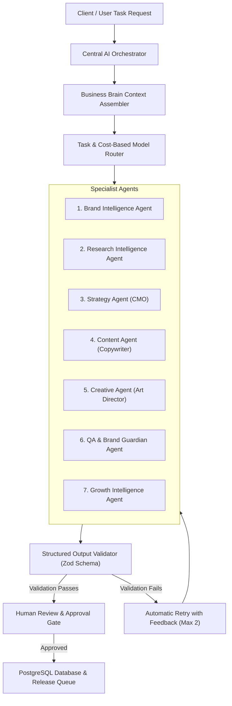

# SWAPNO AI — AI AGENT ARCHITECTURE
**Document ID:** `07-AI-AGENT-ARCHITECTURE`  
**Phase:** Foundation Sprint (Phases 1 & 2)  
**Date:** November 2026  
**Auditor / AI Architect:** Senior AI Systems & LLM Architect  
**Status:** Target AI architecture proposal; no multi-agent orchestrator or production generation router is implemented. See `docs/AI-PROVIDER-MATRIX.md`.

---

## 1. Central AI Orchestrator & Task Router

SWAPNO AI rejects the fragile paradigm of a single monolithic prompt attempting to handle strategy, copywriting, market research, and design simultaneously. Instead, it utilizes a **Central AI Orchestrator** managing 7 specialized sub-agents through a controlled, deterministic workflow:



---

## 2. The 7 Specialist Agent Specifications

### Agent 1: Brand Intelligence Agent
- **Purpose:** Onboarding architect and brand DNA custodian. Transforms raw business inputs and documents into structured Business Brain nodes.
- **Responsibilities:** Summarizes business identity, detects inconsistencies, suggests missing brand dimensions, and formulates follow-up questions.
- **Inputs:** Business name, raw description, product catalog, customer notes, uploaded PDFs.
- **Output Schema:**
  ```typescript
  interface BrandIntelligenceOutput {
    elevatorPitch: string;
    valueProposition: string;
    detectedTone: string;
    suggestedCompetitors: Array<{ name: string; type: 'direct' | 'indirect'; reason: string }>;
    suggestedKeywords: string[];
    completenessScore: number;
    clarificationQuestions: string[];
  }
  ```
- **Validation Rules:** Never invents products not in the input text; flags all suggested competitors as unverified.

### Agent 2: Research Intelligence Agent
- **Purpose:** Market scanner and trend analyst. Discovers market gaps, buyer motivations, and hashtag momentum.
- **Responsibilities:** Monitors industry keywords, analyzes competitor content themes, and synthesizes target persona pain points.
- **Tools:** Google Search Grounding tool (when enabled in Gemini API) or monitored RSS feeds.
- **Output Schema:**
  ```typescript
  interface ResearchOutput {
    marketOverview: string;
    competitorAnalysis: string;
    trendingHashtags: string[];
    buyerPersonas: Array<{
      name: string;
      ageRange: string;
      goals: string;
      painPoints: string;
      preferredChannels: string[];
    }>;
    growthOpportunities: Array<{ opportunity: string; recommendedAction: string }>;
  }
  ```
- **Validation Rules:** Must cite real search trends or grounded data; never fabricates fake competitor statistics.

### Agent 3: Strategy Agent (Chief Marketing Officer)
- **Purpose:** Translates brand identity and research into an actionable monthly marketing architecture.
- **Responsibilities:** Allocates platform channel mix, constructs 4 cohesive Content Pillars, and devises 2 overarching monthly campaign themes.
- **Inputs:** Confirmed Business Brain, approved Research Dossier, monthly business goal (e.g. leads, awareness).
- **Output Schema:**
  ```typescript
  interface StrategyOutput {
    channelStrategy: Array<{ platform: string; frequencyPerWeek: number; strategicFocus: string }>;
    contentPillars: Array<{ pillarName: string; rationale: string; targetSharePercent: number }>;
    campaignThemes: Array<{ title: string; objective: string; coreHook: string }>;
  }
  ```
- **Human Approval Requirement:** Must be explicitly locked by the business owner before content planning can proceed.

### Agent 4: Content Agent (Senior Copywriter)
- **Purpose:** Platform-specific editorial copywriter. Generates engaging hooks, body copy, calls-to-action (CTAs), and hashtags.
- **Responsibilities:** Crafts platform-optimized captions respecting character limits, line-breaking norms, and brand voice guidelines.
- **Inputs:** Post topic, assigned platform, assigned pillar, brand tone, forbidden rules, reference URLs.
- **Platform Rules:**
  - *LinkedIn:* Spaced paragraphs, professional narrative, thought-leadership hook, clear conversational CTA, 3–4 hashtags.
  - *Instagram:* Engaging opening line, clean emoji spacing, invitation to comment/save, 5–8 targeted hashtags.
  - *Facebook:* Community-oriented, relatable tone, question-based CTA.
  - *Twitter / X:* Punchy hook, under 280 characters, 1–2 hashtags.
- **Output Schema:**
  ```typescript
  interface ContentCopyOutput {
    headline: string;
    contentCopy: string;
    callToAction: string;
    hashtags: string[];
    estimatedReadingTimeSeconds: number;
  }
  ```
- **Validation Rules:** Must strictly adhere to negative rules in Knowledge Vault (e.g. never use forbidden words).

### Agent 5: Creative Agent (Art Director)
- **Purpose:** Visual strategist. Generates detailed photography prompts, layout instructions, and visual assets.
- **Responsibilities:** Formulates prompt parameters for image generation APIs, specifies aspect ratios, and aligns visual palettes with brand HEX codes.
- **Inputs:** Content item title, copy summary, visual aesthetic guidelines, brand colors.
- **Output Schema:**
  ```typescript
  interface CreativeOutput {
    visualConcept: string;
    imagePrompt: string;
    suggestedAspectRatio: '1:1' | '4:5' | '9:16' | '16:9';
    colorPaletteSuggestions: string[];
    designNotes: string;
  }
  ```
- **Asset Preservation Invariant:** Original uploaded logos and real product photos must never be distorted or replaced by AI synthesis.

### Agent 6: Quality Assurance & Brand Guardian Agent
- **Purpose:** Safety, tone alignment, and compliance guardian. Audits all generated copy and creative concepts before presenting them to the user.
- **Responsibilities:** Scans for forbidden words, policy violations, hallucinations, grammatical errors, and tone drift.
- **Output Schema:**
  ```typescript
  interface QACheckOutput {
    passed: boolean;
    brandToneAlignmentScore: number; // 0 - 100
    violationsFound: string[];
    correctionSuggestions: string[];
  }
  ```
- **Action:** If `passed === false`, returns payload to the originating agent for 1 automatic self-correction cycle.

### Agent 7: Growth Intelligence Agent
- **Purpose:** Data analyst and growth strategist. Evaluates organic telemetry and drives the closed-loop learning cycle.
- **Responsibilities:** Audits post reach, clicks, and engagement; identifies winning pillars; recommends strategy modifications for next month.
- **Inputs:** Real historical analytics records from Meta Graph API.
- **Output Schema:**
  ```typescript
  interface GrowthAnalysisOutput {
    executiveSummary: string;
    topPerformingPillars: string[];
    underperformingFormats: string[];
    actionableRecommendations: string[];
    learnedRulesToInject: string[];
  }
  ```

---

## 3. Multi-Model Provider & Routing Strategy

SWAPNO AI utilizes a **task-based, tiered model routing architecture** to balance quality, latency, and cost:

| Tier | Target Tasks | Primary Model | Fallback Model | Cost per 1M Tokens |
|---|---|---|---|---|
| **Tier 1: High-Speed & Low-Cost** | Post captions, hashtags, summaries, micro-copy, UI suggestions | **Google Gemini 2.0 Flash** | OpenAI GPT-4o-mini | ~\$0.10 / \$0.40 |
| **Tier 2: Deep Strategic Reasoning** | Business Brain synthesis, CMO Strategy, Competitor Analysis, Growth Audits | **Google Gemini 1.5 Pro** | Anthropic Claude 3.5 Sonnet (via OpenRouter) | ~\$1.25 / \$5.00 |
| **Tier 3: Visual Image Generation** | Bespoke photography synthesis, visual cards | **Google Imagen 3** | FLUX.1 Schnell / Recraft | ~\$0.03 / image |

### Rate Limiting, Cost Tracking, and Graceful Fallback
- **Cost Tracking:** Every LLM call records `prompt_tokens`, `completion_tokens`, `model_name`, `estimated_cost_usd`, and `workspace_id` in the `ai_usage_logs` table.
- **Tenant Quotas:** Workspaces have strict monthly token and image budgets enforced at the API gateway layer.
- **Graceful Fallback Policy:** If a primary model fails or experiences rate-limiting (HTTP 429 / 503), the router switches to the secondary model. **Under no circumstances will the system silently return hardcoded mock responses without notifying the user.** If all providers fail, an explicit error state (`AI_GENERATION_FAILED`) is returned to the client.
