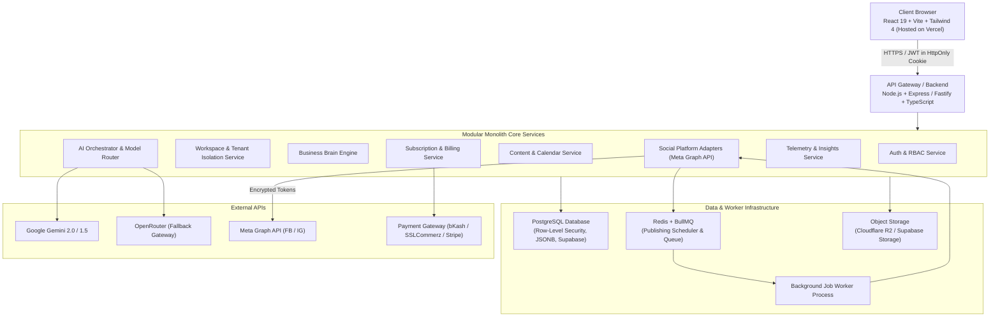
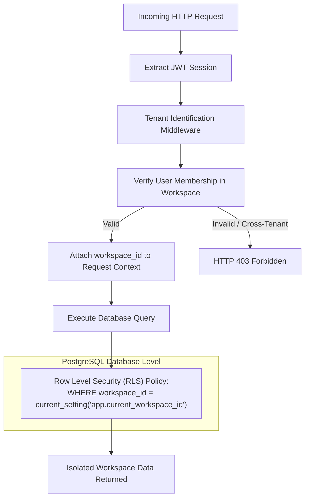

# SWAPNO AI — TECHNICAL ARCHITECTURE
**Document ID:** `08-TECHNICAL-ARCHITECTURE`  
**Phase:** Foundation Sprint (Phases 1 & 2)  
**Date:** November 2026  
**Auditor / Chief Architect:** Senior Full-Stack Software & Systems Architect  
**Status:** Target architecture proposal, not current runtime. The implemented architecture and deployment blockers are documented in `docs/ARCHITECTURE.md` and `docs/DEPLOYMENT-GUIDE.md`.

---

## 1. Target SaaS System Architecture

SWAPNO AI transitions from the prototype's single-file flat database to a **Modular Monolith** designed for high reliability, strict multi-tenancy, and low initial operating costs:



---

## 2. Multi-Tenancy & Data Isolation Model

Tenant isolation is enforced strictly at the **backend and database layers**. Under no circumstances will tenant filtering rely solely on frontend client parameters.



### Isolation Rules
1. **Foreign Key Enforcement:** Every business entity (`brands`, `content_items`, `social_accounts`, `analytics_snapshots`, `ai_usage_logs`) contains a mandatory, indexed `workspace_id` foreign key.
2. **PostgreSQL Row-Level Security (RLS):** Enabled across all tenant tables. Even if a backend query developer forgets a `WHERE workspace_id = ...` clause, the database itself rejects records belonging to other workspaces.
3. **Storage Bucket Scoping:** All uploaded brand assets and generated images are segregated into paths: `/workspaces/{workspace_id}/assets/{asset_id}`.

---

## 3. Core Subsystem Architecture

### 3.1 Authentication & Role-Based Access Control (RBAC)
- **Engine:** Supabase Auth or self-hosted PostgreSQL JWT with refresh tokens.
- **Session Delivery:** Secure, HTTP-only, SameSite=Strict cookies to prevent XSS credential theft.
- **User Roles within Workspace:**
  - `owner`: Full control, billing, invitations, platform connections, publishing.
  - `admin`: Manages brain, strategy, approves and publishes posts; no billing access.
  - `editor`: Creates drafts, edits copy, generates images; cannot publish directly without approval.
  - `viewer`: Read-only access to calendar and analytics reports.

### 3.2 Asynchronous Job Queue & Precision Scheduler
A reliable SaaS cannot use `setTimeout` or in-memory intervals for scheduled publishing.
- **Queue Engine:** **BullMQ on Redis**.
- **Worker Responsibilities:**
  1. *Publishing Worker:* Wakes up every minute, evaluates scheduled jobs, pulls approved media from Object Storage, calls Meta Graph API, updates database with remote post ID.
  2. *Retry Worker:* Implements exponential backoff (retry after 2 min, 5 min, 15 min) for network hiccups.
  3. *Telemetry Worker:* Ingests post impressions, likes, and comments every 6 hours.

### 3.3 Social Media Adapter Layer
All social platform integrations implement a unified `SocialPlatformAdapter` interface:
```typescript
interface SocialPlatformAdapter {
  platformName: 'facebook' | 'instagram' | 'linkedin' | 'twitter';
  generateOAuthUrl(workspaceId: string, redirectUri: string): Promise<string>;
  exchangeCodeForToken(code: string): Promise<EncryptedTokenPayload>;
  refreshAccessToken(currentToken: string): Promise<EncryptedTokenPayload>;
  validateContent(item: ContentItem): ValidationResult;
  publishPost(item: ContentItem, token: string): Promise<PublishResult>;
  fetchMetrics(remotePostId: string, token: string): Promise<PostMetrics>;
}
```
This guarantees that adding LinkedIn, TikTok, or X in later phases requires zero modifications to the core Content or Calendar engines.

---

## 4. Hosting & Infrastructure Comparison

| Dimension | Option A: Vercel + Supabase (Recommended Starter) | Option B: Standalone VPS (Hetzner / DigitalOcean) | Option C: Render / Railway |
|---|---|---|---|
| **Architecture** | Frontend on Vercel Edge; Database, Auth & Storage on Supabase; Background worker on Render/Railway. | Full stack (Docker compose: Node + Postgres + Redis + Nginx) on single VPS. | PaaS container instances for Web and Worker; managed Postgres & Redis. |
| **Initial Cost** | **\$0 – \$25 / month** (Generous free tiers for MVP development). | **\$10 – \$20 / month** (Fixed cost). | **\$15 – \$40 / month**. |
| **Operational Overhead** | **Very Low.** Fully managed backups, TLS, database pooling, and OAuth providers. | **High.** Requires manual Linux administration, security patches, firewall setup, Docker management. | **Low.** Managed container builds and auto-deployments. |
| **Scalability** | Instant global CDN for frontend; database scales automatically. | Limited to single server specs until cluster reconfiguration. | Automatic vertical scaling. |
| **Recommendation** | **STRONGLY RECOMMENDED FOR PHASE 3+** | Suitable for late-stage cost optimization when user volume exceeds 5,000 businesses. | Good alternative if Supabase is not chosen. |

---

## 5. Security & Secret Management

1. **OAuth Token Encryption:** Access tokens for Facebook and Instagram are encrypted at rest using **AES-256-GCM** before writing to PostgreSQL. The encryption key (`TOKEN_ENCRYPTION_SECRET`) is stored strictly in server environment variables.
2. **Frontend Zero-Trust:** Secrets (`GEMINI_API_KEY`, `META_APP_SECRET`, database passwords) never touch the client browser.
3. **CORS & Rate Limiting:** API endpoints protected by `express-rate-limit` (100 req/min for standard endpoints, 10 req/min for AI generation).
4. **Input Sanitization:** All incoming JSON payloads validated against strict Zod schemas to eliminate injection and malformed crashes.
