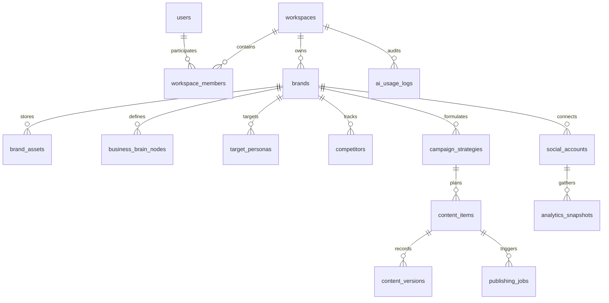

# SWAPNO AI — DATABASE AND API PLAN
**Document ID:** `09-DATABASE-AND-API-PLAN`  
**Phase:** Foundation Sprint (Phases 1 & 2)  
**Date:** November 2026  
**Auditor / Database Architect:** Senior Database & Backend Architect  
**Status:** Approved DDL & API Specification  

---

## 1. Relational Database Schema (PostgreSQL)

The entire data architecture is redesigned to replace the single flat `db.json` with a fully normalized, relational schema in PostgreSQL:



### 1.1 Complete DDL Table Specifications

```sql
-- Enable UUID extension
CREATE EXTENSION IF NOT EXISTS "uuid-ossp";

-- 1. USERS TABLE
CREATE TABLE users (
    id UUID PRIMARY KEY DEFAULT uuid_generate_v4(),
    email VARCHAR(255) UNIQUE NOT NULL,
    encrypted_password VARCHAR(255),
    full_name VARCHAR(255) NOT NULL,
    avatar_url TEXT,
    created_at TIMESTAMPTZ DEFAULT NOW(),
    updated_at TIMESTAMPTZ DEFAULT NOW()
);

-- 2. WORKSPACES TABLE (Tenant Root)
CREATE TABLE workspaces (
    id UUID PRIMARY KEY DEFAULT uuid_generate_v4(),
    name VARCHAR(255) NOT NULL,
    slug VARCHAR(255) UNIQUE NOT NULL,
    plan_tier VARCHAR(50) DEFAULT 'starter' CHECK (plan_tier IN ('starter', 'growth', 'pro', 'agency')),
    subscription_status VARCHAR(50) DEFAULT 'active' CHECK (subscription_status IN ('active', 'trialing', 'past_due', 'canceled')),
    created_at TIMESTAMPTZ DEFAULT NOW(),
    updated_at TIMESTAMPTZ DEFAULT NOW()
);

-- 3. WORKSPACE MEMBERS (RBAC)
CREATE TABLE workspace_members (
    id UUID PRIMARY KEY DEFAULT uuid_generate_v4(),
    workspace_id UUID NOT NULL REFERENCES workspaces(id) ON DELETE CASCADE,
    user_id UUID NOT NULL REFERENCES users(id) ON DELETE CASCADE,
    role VARCHAR(50) NOT NULL DEFAULT 'editor' CHECK (role IN ('owner', 'admin', 'editor', 'viewer')),
    created_at TIMESTAMPTZ DEFAULT NOW(),
    UNIQUE(workspace_id, user_id)
);

-- 4. BRANDS TABLE
CREATE TABLE brands (
    id UUID PRIMARY KEY DEFAULT uuid_generate_v4(),
    workspace_id UUID NOT NULL REFERENCES workspaces(id) ON DELETE CASCADE,
    name VARCHAR(255) NOT NULL,
    industry VARCHAR(100) NOT NULL,
    sub_industry VARCHAR(100),
    description TEXT,
    tone VARCHAR(100) DEFAULT 'Professional, Modern',
    primary_color VARCHAR(10) DEFAULT '#EA580C',
    secondary_color VARCHAR(10) DEFAULT '#171717',
    logo_url TEXT,
    website_url TEXT,
    language_mode VARCHAR(50) DEFAULT 'ENGLISH_ONLY',
    created_at TIMESTAMPTZ DEFAULT NOW(),
    updated_at TIMESTAMPTZ DEFAULT NOW()
);

-- 5. BRAND ASSETS (Logos, Product Photos, Videos)
CREATE TABLE brand_assets (
    id UUID PRIMARY KEY DEFAULT uuid_generate_v4(),
    workspace_id UUID NOT NULL REFERENCES workspaces(id) ON DELETE CASCADE,
    brand_id UUID NOT NULL REFERENCES brands(id) ON DELETE CASCADE,
    title VARCHAR(255) NOT NULL,
    storage_path TEXT NOT NULL,
    cdn_url TEXT NOT NULL,
    asset_type VARCHAR(50) CHECK (asset_type IN ('logo', 'product_image', 'brand_guide', 'video', 'template')),
    tag VARCHAR(50) DEFAULT 'General',
    created_at TIMESTAMPTZ DEFAULT NOW()
);

-- 6. BUSINESS BRAIN NODES & RULES
CREATE TABLE business_brain_nodes (
    id UUID PRIMARY KEY DEFAULT uuid_generate_v4(),
    workspace_id UUID NOT NULL REFERENCES workspaces(id) ON DELETE CASCADE,
    brand_id UUID NOT NULL REFERENCES brands(id) ON DELETE CASCADE,
    node_type VARCHAR(50) NOT NULL CHECK (node_type IN ('pitch', 'value_prop', 'negative_rule', 'preference', 'learned_rule')),
    content TEXT NOT NULL,
    is_confirmed BOOLEAN DEFAULT true,
    created_at TIMESTAMPTZ DEFAULT NOW()
);

-- 7. TARGET PERSONAS
CREATE TABLE target_personas (
    id UUID PRIMARY KEY DEFAULT uuid_generate_v4(),
    workspace_id UUID NOT NULL REFERENCES workspaces(id) ON DELETE CASCADE,
    brand_id UUID NOT NULL REFERENCES brands(id) ON DELETE CASCADE,
    name VARCHAR(100) NOT NULL,
    age_range VARCHAR(50),
    goals TEXT,
    pain_points TEXT,
    media_channels TEXT[],
    is_verified BOOLEAN DEFAULT false,
    created_at TIMESTAMPTZ DEFAULT NOW()
);

-- 8. COMPETITORS
CREATE TABLE competitors (
    id UUID PRIMARY KEY DEFAULT uuid_generate_v4(),
    workspace_id UUID NOT NULL REFERENCES workspaces(id) ON DELETE CASCADE,
    brand_id UUID NOT NULL REFERENCES brands(id) ON DELETE CASCADE,
    name VARCHAR(255) NOT NULL,
    competitor_type VARCHAR(50) DEFAULT 'direct' CHECK (competitor_type IN ('direct', 'indirect', 'aspirational')),
    observed_strengths TEXT,
    observed_weaknesses TEXT,
    website_or_social TEXT,
    is_verified BOOLEAN DEFAULT false,
    created_at TIMESTAMPTZ DEFAULT NOW()
);

-- 9. CAMPAIGN STRATEGIES
CREATE TABLE campaign_strategies (
    id UUID PRIMARY KEY DEFAULT uuid_generate_v4(),
    workspace_id UUID NOT NULL REFERENCES workspaces(id) ON DELETE CASCADE,
    brand_id UUID NOT NULL REFERENCES brands(id) ON DELETE CASCADE,
    month_year VARCHAR(20) NOT NULL, -- e.g. '2026-11'
    pillars JSONB NOT NULL,          -- Array of pillar objects
    channels JSONB NOT NULL,         -- Array of channel frequency objects
    campaign_themes JSONB NOT NULL,  -- Array of theme objects
    is_locked BOOLEAN DEFAULT false,
    created_at TIMESTAMPTZ DEFAULT NOW(),
    updated_at TIMESTAMPTZ DEFAULT NOW()
);

-- 10. CONTENT ITEMS (Posts & Creatives)
CREATE TABLE content_items (
    id UUID PRIMARY KEY DEFAULT uuid_generate_v4(),
    workspace_id UUID NOT NULL REFERENCES workspaces(id) ON DELETE CASCADE,
    brand_id UUID NOT NULL REFERENCES brands(id) ON DELETE CASCADE,
    strategy_id UUID REFERENCES campaign_strategies(id) ON DELETE SET NULL,
    title VARCHAR(255) NOT NULL,
    platform VARCHAR(50) NOT NULL CHECK (platform IN ('facebook', 'instagram', 'linkedin', 'twitter', 'tiktok', 'youtube')),
    scheduled_at TIMESTAMPTZ,
    pillar VARCHAR(100),
    status VARCHAR(50) DEFAULT 'planned' CHECK (status IN ('planned', 'approved', 'scheduled', 'publishing', 'published', 'failed')),
    content_copy TEXT,
    hashtags TEXT[],
    image_prompt TEXT,
    media_url TEXT,
    notes TEXT,
    approved_by UUID REFERENCES users(id),
    approved_at TIMESTAMPTZ,
    remote_post_id VARCHAR(255),
    created_at TIMESTAMPTZ DEFAULT NOW(),
    updated_at TIMESTAMPTZ DEFAULT NOW()
);

-- 11. CONTENT VERSIONS (Audit History)
CREATE TABLE content_versions (
    id UUID PRIMARY KEY DEFAULT uuid_generate_v4(),
    content_item_id UUID NOT NULL REFERENCES content_items(id) ON DELETE CASCADE,
    version_number INT NOT NULL,
    content_copy TEXT NOT NULL,
    modified_by UUID REFERENCES users(id),
    created_at TIMESTAMPTZ DEFAULT NOW()
);

-- 12. SOCIAL ACCOUNTS (Encrypted OAuth Tokens)
CREATE TABLE social_accounts (
    id UUID PRIMARY KEY DEFAULT uuid_generate_v4(),
    workspace_id UUID NOT NULL REFERENCES workspaces(id) ON DELETE CASCADE,
    brand_id UUID NOT NULL REFERENCES brands(id) ON DELETE CASCADE,
    platform VARCHAR(50) NOT NULL CHECK (platform IN ('facebook', 'instagram', 'linkedin', 'twitter')),
    account_name VARCHAR(255) NOT NULL,
    remote_account_id VARCHAR(255) NOT NULL,
    encrypted_access_token TEXT NOT NULL,
    token_expires_at TIMESTAMPTZ,
    connection_status VARCHAR(50) DEFAULT 'active' CHECK (connection_status IN ('active', 'expired', 'revoked')),
    created_at TIMESTAMPTZ DEFAULT NOW(),
    updated_at TIMESTAMPTZ DEFAULT NOW()
);

-- 13. PUBLISHING JOBS QUEUE
CREATE TABLE publishing_jobs (
    id UUID PRIMARY KEY DEFAULT uuid_generate_v4(),
    workspace_id UUID NOT NULL REFERENCES workspaces(id) ON DELETE CASCADE,
    content_item_id UUID NOT NULL REFERENCES content_items(id) ON DELETE CASCADE,
    social_account_id UUID NOT NULL REFERENCES social_accounts(id) ON DELETE CASCADE,
    scheduled_for TIMESTAMPTZ NOT NULL,
    status VARCHAR(50) DEFAULT 'pending' CHECK (status IN ('pending', 'processing', 'completed', 'failed')),
    attempt_count INT DEFAULT 0,
    last_error TEXT,
    completed_at TIMESTAMPTZ,
    created_at TIMESTAMPTZ DEFAULT NOW()
);

-- 14. ANALYTICS SNAPSHOTS
CREATE TABLE analytics_snapshots (
    id UUID PRIMARY KEY DEFAULT uuid_generate_v4(),
    workspace_id UUID NOT NULL REFERENCES workspaces(id) ON DELETE CASCADE,
    content_item_id UUID REFERENCES content_items(id) ON DELETE CASCADE,
    social_account_id UUID REFERENCES social_accounts(id) ON DELETE CASCADE,
    snapshot_date DATE NOT NULL,
    impressions INT DEFAULT 0,
    reach INT DEFAULT 0,
    engagement INT DEFAULT 0,
    clicks INT DEFAULT 0,
    created_at TIMESTAMPTZ DEFAULT NOW()
);

-- 15. AI USAGE LOGS (Cost & Audit Tracking)
CREATE TABLE ai_usage_logs (
    id UUID PRIMARY KEY DEFAULT uuid_generate_v4(),
    workspace_id UUID NOT NULL REFERENCES workspaces(id) ON DELETE CASCADE,
    user_id UUID REFERENCES users(id),
    agent_name VARCHAR(100) NOT NULL,
    model_name VARCHAR(100) NOT NULL,
    prompt_tokens INT NOT NULL,
    completion_tokens INT NOT NULL,
    estimated_cost_usd NUMERIC(10, 6) NOT NULL,
    created_at TIMESTAMPTZ DEFAULT NOW()
);
```

---

## 2. API Specification (REST / JSON)

### 2.1 Authentication & Workspaces
- `POST /api/v1/auth/signup` $\rightarrow$ `{ email, password, full_name }` $\Rightarrow$ `201 Created`
- `POST /api/v1/auth/login` $\rightarrow$ `{ email, password }` $\Rightarrow$ `200 OK + Set-Cookie (jwt)`
- `POST /api/v1/auth/logout` $\rightarrow$ Clears session cookie $\Rightarrow$ `200 OK`
- `GET /api/v1/workspaces` $\rightarrow$ Returns workspaces user belongs to $\Rightarrow$ `200 OK`
- `POST /api/v1/workspaces` $\rightarrow$ `{ name, slug }` $\Rightarrow$ `201 Created`

### 2.2 Brand & Business Brain
- `GET /api/v1/brands/:brandId` $\rightarrow$ Returns brand details & brain nodes $\Rightarrow$ `200 OK`
- `PUT /api/v1/brands/:brandId` $\rightarrow$ Update brand coordinates $\Rightarrow$ `200 OK`
- `POST /api/v1/brands/:brandId/assets` $\rightarrow$ Multipart file upload to storage $\Rightarrow$ `201 Created`
- `POST /api/v1/brands/:brandId/brain-nodes` $\rightarrow$ `{ node_type, content }` $\Rightarrow$ `201 Created`
- `DELETE /api/v1/brands/:brandId/brain-nodes/:nodeId` $\rightarrow$ Deletes node $\Rightarrow$ `200 OK`

### 2.3 AI Orchestrator Endpoints
- `POST /api/v1/ai/brainstorm-pitch` $\rightarrow$ Calls Brand Intelligence Agent $\Rightarrow$ `{ elevatorPitch, valueProp }`
- `POST /api/v1/ai/research-market` $\rightarrow$ Calls Research Agent with grounding $\Rightarrow$ `{ marketOverview, hashtags, personas }`
- `POST /api/v1/ai/generate-strategy` $\rightarrow$ Calls Strategy Agent $\Rightarrow$ `{ pillars, channels, themes }`
- `POST /api/v1/ai/generate-calendar` $\rightarrow$ Calls Content Agent $\Rightarrow$ `{ items: [...] }`
- `POST /api/v1/ai/generate-copy` $\rightarrow$ Calls Copywriting Agent $\Rightarrow$ `{ contentCopy, hashtags, cta }`
- `POST /api/v1/ai/generate-image` $\rightarrow$ Calls Creative Agent + Image API $\Rightarrow$ `{ mediaUrl, prompt }`
- `POST /api/v1/ai/chat` $\rightarrow$ Floating Copilot chat with active context $\Rightarrow$ `{ reply, reasoning, impact }`

### 2.4 Content, Publishing & Queues
- `GET /api/v1/content?month=2026-11` $\rightarrow$ Returns monthly content items $\Rightarrow$ `200 OK`
- `POST /api/v1/content` $\rightarrow$ Creates new draft item $\Rightarrow$ `201 Created`
- `PUT /api/v1/content/:id` $\rightarrow$ Updates item copy, date, pillar $\Rightarrow$ `200 OK`
- `POST /api/v1/content/:id/approve` $\rightarrow$ Toggles approval status $\Rightarrow$ `200 OK`
- `POST /api/v1/content/bulk-approve` $\rightarrow$ Bulk approves planned items $\Rightarrow$ `200 OK`
- `POST /api/v1/content/:id/publish-now` $\rightarrow$ Enqueues high-priority dispatch $\Rightarrow$ `202 Accepted`

### 2.5 Social Connections & Telemetry
- `GET /api/v1/integrations/meta/oauth-url` $\rightarrow$ Returns official Facebook OAuth login URL $\Rightarrow$ `200 OK`
- `POST /api/v1/integrations/meta/callback` $\rightarrow$ Exchanges code for encrypted token $\Rightarrow$ `200 OK`
- `DELETE /api/v1/integrations/:accountId` $\rightarrow$ Revokes token & disconnects $\Rightarrow$ `200 OK`
- `GET /api/v1/analytics/overview` $\rightarrow$ Aggregated impressions, reach, clicks $\Rightarrow$ `200 OK`
- `GET /api/v1/analytics/export-pdf` $\rightarrow$ Generates real executive PDF dossier $\Rightarrow$ `200 OK (application/pdf)`
