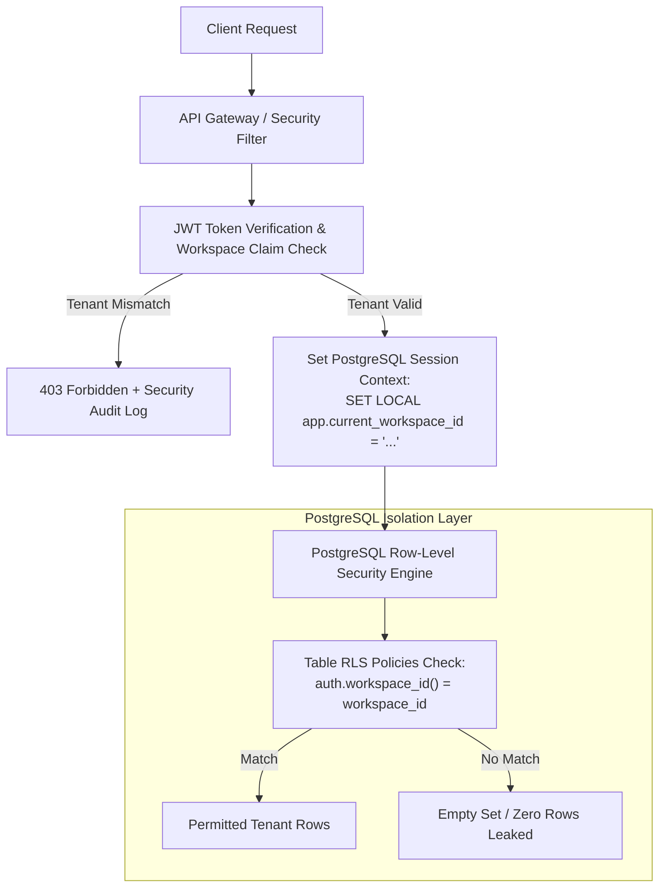
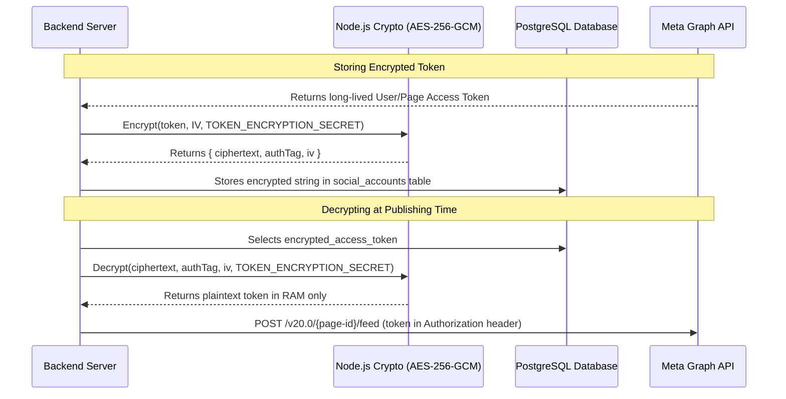

# SWAPNO AI — SECURITY AND SAAS PLAN
**Document ID:** `10-SECURITY-AND-SAAS-PLAN`  
**Phase:** Foundation Sprint (Phases 1 & 2)  
**Date:** November 2026  
**Auditor / Security Architect:** Senior SaaS Security & Cloud Infrastructure Architect  
**Status:** Proposed target security plan; controls shown below are not necessarily implemented or verified. Current controls and blockers are in `docs/SECURITY-AND-PRIVACY.md`.

---

## 1. Multi-Tenant Isolation & Leakage Prevention

The absolute primary mandate of SWAPNO AI is that **no business can ever read, modify, or leak data belonging to another business**.



### PostgreSQL Row-Level Security Policies
Every table containing customer data has RLS enabled by default:
```sql
-- Enable RLS on all sensitive tables
ALTER TABLE brands ENABLE ROW LEVEL SECURITY;
ALTER TABLE content_items ENABLE ROW LEVEL SECURITY;
ALTER TABLE social_accounts ENABLE ROW LEVEL SECURITY;
ALTER TABLE business_brain_nodes ENABLE ROW LEVEL SECURITY;
ALTER TABLE brand_assets ENABLE ROW LEVEL SECURITY;

-- Tenant Isolation Policy Example for Content Items
CREATE POLICY tenant_isolation_policy ON content_items
    FOR ALL
    USING (workspace_id = NULLIF(current_setting('app.current_workspace_id', true), '')::UUID);
```

---

## 2. Role-Based Access Control (RBAC) Matrix

Workspaces support 4 distinct membership roles to prevent unauthorized modifications:

| Operation | `owner` | `admin` | `editor` | `viewer` |
|---|:---:|:---:|:---:|:---:|
| **Delete Workspace / Transfer Ownership** | ✅ | ❌ | ❌ | ❌ |
| **Manage Billing, Invoices & Subscriptions** | ✅ | ❌ | ❌ | ❌ |
| **Invite / Remove Team Members** | ✅ | ✅ | ❌ | ❌ |
| **Connect / Disconnect Social Accounts (OAuth)** | ✅ | ✅ | ❌ | ❌ |
| **Lock Business Brain & Strategy Pillars** | ✅ | ✅ | ❌ | ❌ |
| **Approve Posts for Publication** | ✅ | ✅ | ❌ | ❌ |
| **Dispatch Immediate "Publish Now"** | ✅ | ✅ | ❌ | ❌ |
| **Create Drafts, Edit Copy, Generate Images** | ✅ | ✅ | ✅ | ❌ |
| **View Calendar, Analytics & PDF Dossiers** | ✅ | ✅ | ✅ | ✅ |

---

## 3. Social Media Token Encryption & Secrets Management

### 3.1 Encryption at Rest (AES-256-GCM)
Access tokens for Facebook Pages and Instagram Professional accounts give direct authority to post to public business feeds. Storing them in plaintext is a catastrophic security vulnerability.



### 3.2 Automated Token Refresh & Health Monitoring
- Long-lived Meta user access tokens expire after 60 days.
- A weekly maintenance worker scans `social_accounts` where `token_expires_at < NOW() + INTERVAL '14 days'`.
- Attempts silent token refresh via Meta's `GET /oauth/access_token?grant_type=fb_exchange_token`.
- If refresh fails or permissions are revoked, sets `connection_status = 'expired'` and alerts the workspace owner via email and Command Center notification. Never attempt publishing with an invalid token.

---

## 4. AI Cost Protection & Abuse Prevention

Uncontrolled LLM usage can bankrupt a SaaS or result in severe denial-of-wallet attacks.

### 4.1 Tiered Monthly Token Caps
- **Starter (৳999):** 100,000 prompt tokens / 50,000 completion tokens / 15 image calls per month.
- **Growth (৳1,999):** 400,000 prompt tokens / 200,000 completion tokens / 45 image calls per month.
- **Pro (৳3,999):** 1,200,000 prompt tokens / 600,000 completion tokens / 120 image calls per month.
- **Agency (৳7,999):** Custom pooled quotas.

### 4.2 Rate Limiting per Workspace
- General AI Generation endpoints: Max **10 requests per minute** per workspace.
- Floating Chat Copilot: Max **20 messages per 10 minutes** per user.
- Image Generation: Max **3 concurrent requests** per workspace.

### 4.3 Prompt Injection Defense & Input Sanitization
- User inputs (business descriptions, custom instructions) are sanitized and stripped of control sequences (`system:`, `human:`, `ignore previous instructions`).
- Business Brain context is injected into immutable system prompts via strictly delimited XML/JSON tags.
- Zod schema validation strips any unapproved fields returned by LLMs before saving to PostgreSQL.

---

## 5. Backup, Disaster Recovery, and Audit Trails

1. **Daily Automated Snapshots:** PostgreSQL database backed up daily at 03:00 UTC with 30-day rolling retention.
2. **Point-in-Time Recovery (PITR):** Write-Ahead Logging (WAL) enabled on Supabase/managed PostgreSQL for 7-day point-in-time recovery.
3. **Audit Logging:** Every sensitive action (membership changes, OAuth disconnections, bulk content deletions, manual state flushes) is logged to `audit_logs` with `user_id`, `ip_address`, `timestamp`, and `action_type`.
