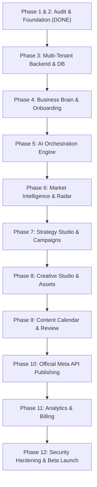

# SWAPNO AI — DEVELOPMENT ROADMAP
**Document ID:** `11-DEVELOPMENT-ROADMAP`  
**Phase:** Foundation Sprint (Phases 1 & 2)  
**Date:** November 2026  
**Auditor / Engineering Lead:** Senior Full-Stack Engineering Manager & Architect  
**Status:** Historical proposed roadmap, not an approved schedule. The current prioritized backlog is `docs/PRODUCT-ROADMAP.md`.

---

## 1. Roadmap Overview & Phasing Principles

To transform SWAPNO AI from a single-file prototype into an enterprise-grade, sellable SaaS, development must proceed **strictly in dependency order**.

**Why this order?**
- You cannot store a Business Brain without a multi-tenant database (Phase 3 before 4).
- You cannot generate reliable marketing strategy without an active Business Brain (Phase 4 before 5 & 7).
- You cannot publish content to Facebook/Instagram without an approved calendar and real OAuth credentials (Phase 9 before 10).
- You cannot collect real analytics or charge customers without functioning publication (Phase 10 before 11).

---

## 2. Phase-by-Phase Implementation Specifications

### Phase 3: SaaS Backend & Multi-Tenant Infrastructure
- **Objective:** Replace flat `db.json` with PostgreSQL, implement real user authentication, workspace creation, and tenant isolation.
- **Features:** User registration, email/password login, Google OAuth, workspace provisioning, workspace member invitations, tenant context middleware.
- **Database Changes:** Run DDL migrations for `users`, `workspaces`, `workspace_members`, and configure Row-Level Security policies.
- **API Changes:** Implement `/api/v1/auth/*`, `/api/v1/workspaces/*`. Deprecate unauthenticated `/api/state` and `/api/reset`.
- **UI Changes:** Connect `Login.tsx` to real authentication endpoints; replace static Workspace A/B toggle with a dynamic workspace dropdown selector.
- **Test Plan:** Register 3 distinct accounts; verify that User A cannot read or modify User B's workspace data.
- **Acceptance Criteria:** Full authentication flow works; database persists multi-user data; zero unauthenticated data leaks.
- **Complexity:** High | **Cost Impact:** Minimal (\$0–\$25/mo on Supabase/Vercel).

### Phase 4: Business Brain & Progressive Onboarding
- **Objective:** Construct the 6-dimensional Business Brain ontology and guided onboarding wizard.
- **Features:** 3-minute onboarding flow, identity coordinates editor, Knowledge Vault (negative rules), Brand Asset Library file upload, completeness score meter.
- **Database Changes:** Migrations for `brands`, `brand_assets`, `business_brain_nodes`.
- **API Changes:** `/api/v1/brands/*`, `/api/v1/brands/:id/assets` (multipart file upload to object storage), `/api/v1/brands/:id/brain-nodes`.
- **UI Changes:** Wire up Brand Profile screen and Knowledge Vault to real REST endpoints; integrate drag-and-drop file uploader for logos and product photos.
- **Test Plan:** Complete onboarding with test brand (e.g. Dhaka Flower Tub); verify all coordinates and uploaded images persist.
- **Acceptance Criteria:** Brand Brain updates in real-time; file uploads return valid CDN URLs; completeness meter reflects filled fields.
- **Complexity:** Medium | **Cost Impact:** Storage costs (negligible for initial beta).

### Phase 5: AI Orchestration & Multi-Model Router
- **Objective:** Build the central AI Orchestrator, structured output validator, and task-based model router.
- **Features:** Tiered model routing (Gemini 2.0 Flash for speed/cost, Gemini 1.5 Pro for deep reasoning), Zod schema enforcement, token & cost tracking per workspace, graceful fallback logic without silent mock generation.
- **Database Changes:** Migration for `ai_usage_logs`.
- **API Changes:** Update `/api/v1/ai/*` to pass through Orchestrator with structured schemas; deprecate `server.ts` legacy fallback code.
- **UI Changes:** Connect `FloatingAI.tsx` to the new Orchestrator; display transparent model loading states.
- **Test Plan:** Simulate model timeouts and verify explicit error reporting; verify all returned JSON strictly conforms to Zod schemas.
- **Acceptance Criteria:** 100% of LLM calls produce valid, typed JSON; every call logs tokens and cost to database.
- **Complexity:** High | **Cost Impact:** API usage (~\$5–\$20/mo during development).

### Phase 6: Market Intelligence & Research Radar
- **Objective:** Activate live market research, competitor monitoring, and search trend analysis.
- **Features:** Industry overview scanner, buyer persona synthesis, hashtag momentum discovery, structured research cards ("What Changed? Why It Matters? What Should I Do?").
- **Database Changes:** Migrations for `target_personas`, `competitors`.
- **API Changes:** `/api/v1/ai/research-market`, `/api/v1/competitors/*`.
- **UI Changes:** Dynamically render `MarketIntelligence.tsx` from database records rather than hardcoded cards.
- **Test Plan:** Trigger research for 3 different industries (e.g. Interior Design, Gourmet Dining, Boutique Fashion); verify outputs adapt dynamically.
- **Acceptance Criteria:** Real persona records saved to DB; competitor records marked as `is_verified: false` until user confirms.
- **Complexity:** Medium | **Cost Impact:** Low.

### Phase 7: Strategy Studio & Campaign Architect
- **Objective:** Build the CMO Strategy engine for multi-channel allocation, content pillars, and monthly campaign themes.
- **Features:** Strategic channel proposal, 4 editable Content Pillars, 2 monthly campaign themes, Strategy Locking mechanism.
- **Database Changes:** Migration for `campaign_strategies`.
- **API Changes:** `/api/v1/strategies/*`, `/api/v1/ai/generate-strategy`.
- **UI Changes:** Dedicated Strategy Studio view with pillar re-ordering, frequency sliders, and "Lock Strategy" button.
- **Test Plan:** Generate strategy; edit 1 pillar title; lock strategy; verify locked state restricts unauthorized edits.
- **Acceptance Criteria:** Strategy brief locked and passed seamlessly to calendar generator.
- **Complexity:** Medium | **Cost Impact:** Low.

### Phase 8: Creative Studio & Brand Asset Pipeline
- **Objective:** Real visual asset generation and image management with strict asset preservation rules.
- **Features:** High-resolution image prompt generation, dedicated image model integration (Google Imagen 3 / FLUX), brand color palette injection, asset preservation checks for original product photos and logos.
- **Database Changes:** Asset associations on `content_items`.
- **API Changes:** `/api/v1/ai/generate-image`, `/api/v1/creative/pair-asset`.
- **UI Changes:** Creative Canvas drawer, aspect ratio toggle (1:1, 4:5, 9:16), Unsplash fallback replaced with real generation or uploaded brand assets.
- **Test Plan:** Generate bespoke image; verify aspect ratio and CDN storage; verify original product photos are never altered.
- **Acceptance Criteria:** Generated images stored in private S3/R2 bucket with public CDN links attached to post items.
- **Complexity:** High | **Cost Impact:** ~$0.03 per image generation call.

### Phase 9: Content Calendar & Publishing Hub
- **Objective:** 30-day monthly calendar generation, multi-platform preview, editorial editing, and approval workflows.
- **Features:** 30-day schedule generation, drag-and-drop calendar UI, multi-platform live preview cards (LinkedIn, Instagram, Facebook, Twitter), post duplication, revision history, single & bulk approval buttons.
- **Database Changes:** Migrations for `content_items`, `content_versions`.
- **API Changes:** Full CRUD on `/api/v1/content/*`, `/api/v1/content/bulk-approve`.
- **UI Changes:** Complete integration of `ContentStudio.tsx` with backend PostgreSQL state; elimination of in-memory data resets.
- **Test Plan:** Generate 30 posts; edit 3 captions; verify version history saves previous drafts; execute bulk approval.
- **Acceptance Criteria:** Full month of posts editable, approved, and ready for queue dispatch.
- **Complexity:** High | **Cost Impact:** Low.

### Phase 10: Official Social Platform Integrations (Meta Graph API)
- **Objective:** Real Facebook Page and Instagram Professional account OAuth connection and automated publishing worker.
- **Features:** Official Meta OAuth 2.0 flow, token exchange, AES-256-GCM token encryption, Redis/BullMQ publishing queue, precision cron worker, immediate "Publish Now" dispatch, remote post ID verification.
- **Database Changes:** Migrations for `social_accounts`, `publishing_jobs`.
- **API Changes:** `/api/v1/integrations/meta/*`, `/api/v1/publishing/*`.
- **UI Changes:** Real Meta OAuth popup window in Connections page; live connection status indicators; real publishing logs.
- **Test Plan:** Connect real test Facebook Page and Instagram Professional account; schedule a post for 2 minutes in future; verify worker publishes post and captures remote post ID.
- **Acceptance Criteria:** Post physically appears on live Facebook/Instagram feeds; status changes to `published` ONLY upon HTTP 200 from Meta.
- **Complexity:** Very High | **Cost Impact:** Requires Meta Developer App setup and Business Verification.

### Phase 11: Analytics, Growth Loop & Billing Integration
- **Objective:** Real social telemetry ingestion, closed-loop AI performance evaluation, and local/international payment billing.
- **Features:** Automated 6-hour metrics collector, Growth Agent weekly audit reports, one-click PDF Executive Dossier export, subscription checkout (bKash, SSLCommerz, Stripe).
- **Database Changes:** Migrations for `analytics_snapshots`, workspace billing fields.
- **API Changes:** `/api/v1/analytics/*`, `/api/v1/billing/*`.
- **UI Changes:** Growth Analytics dashboard bound to live telemetry data; billing plan upgrade cards and invoice downloads.
- **Test Plan:** Trigger metrics sync; verify charts reflect real Facebook reach; execute test bKash/Stripe subscription checkout.
- **Acceptance Criteria:** Live charts display authentic data; PDF export compiles real metrics; subscriptions transition workspace plan tiers automatically.
- **Complexity:** High | **Cost Impact:** Payment gateway transaction fees (1.5%–3.5%).

### Phase 12: Security Hardening, QA & Beta Launch
- **Objective:** End-to-end security audit, rate-limit stress testing, and private beta launch with 5–10 real Bangladeshi businesses.
- **Features:** OWASP security scan, penetration test on tenant boundaries, automated database backups verification, error monitoring (Sentry), private beta onboarding (Dhaka Elegance, Dhaka Flower Tub, NiRBAAN).
- **Deliverables:** Production deployment on Vercel + Supabase/Render, automated test suites, customer support channel.
- **Acceptance Criteria:** 10 real businesses actively planning, approving, and publishing their marketing via SWAPNO AI without developer intervention.
- **Complexity:** Medium | **Cost Impact:** Production hosting tier (~\$50–\$100/mo).
