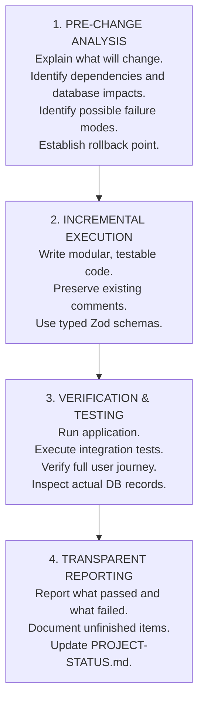

# SWAPNO AI — MASTER PROJECT INSTRUCTIONS
**Document ID:** `12-MASTER-PROJECT-INSTRUCTIONS`  
**Phase:** Foundation Sprint (Phases 1 & 2)  
**Date:** November 2026  
**Auditor / Lead Architect:** Senior SaaS Engineering Director  
**Status:** Invariant Master Operating Rules  

---

## 1. Prime Directives for Future Sprints

Every engineer, AI agent, and developer contributing to **SWAPNO AI — Your Marketing Adviser** must adhere strictly to these invariant engineering principles. No sprint or pull request may violate these rules.

### Rule 1: Never Fake an Integration
- **Zero Simulation Policy:** Never introduce mock `setTimeout` transitions pretending to publish social content, authenticate with OAuth providers, or generate PDF files.
- If an integration or platform API is not yet built, mark its status explicitly as `NOT_CONFIGURED` or `PENDING_SETUP`.
- Never show a post as `published` until the external platform API responds with HTTP 200 and a verified remote post ID.

### Rule 2: Never Fabricate Business Facts or Numbers
- The AI Orchestrator and downstream agents are strictly forbidden from inventing:
  - Product specifications or pricing
  - Customer reviews or testimonials
  - Legal guarantees or warranties
  - Fake competitor statistics or false telemetry
- If specific data is missing from the Business Brain, the AI must ask clarifying questions or explicitly request user input rather than hallucinating plausible fiction.

### Rule 3: Enforce Tenant Isolation at the Database Level
- Never rely on frontend filtering or client-supplied URL parameters to protect business privacy.
- Every database query must be scoped by the authenticated user's active `workspace_id`.
- PostgreSQL Row-Level Security (RLS) must remain enabled on all customer-facing tables at all times.

### Rule 4: Zero Secrets in Frontend Code
- API keys (Gemini, OpenAI, Meta App Secret, Supabase Service Role Key, Stripe Secret Key) must **never** be bundled into client-side code, `.env.local` files served to the browser, or public repositories.
- All external API calls must pass through authenticated backend routes.

### Rule 5: Human-in-the-Loop Approval for Consequential Actions
- The AI suggests, drafts, schedules, and recommends. The human owner reviews, edits, and approves.
- Never build autonomous agents that can publish content to public feeds, change billing subscriptions, or alter critical brand coordinates without explicit human approval.

### Rule 6: Respect Authentic Assets
- The system must preserve authentic user-provided brand assets (vector logos, real product photography, team photos).
- Never allow generative image models to distort, replace, or hallucinate altered versions of real physical products when an authentic asset is designated for use.

---

## 2. Sprint Execution Protocol

Before writing or modifying code in any development phase, follow this 4-step execution protocol:



### Prohibited Development Behaviors
- **DO NOT** rewrite working features without technical justification.
- **DO NOT** start the next phase automatically without human review and approval of the current phase.
- **DO NOT** introduce bloated enterprise frameworks (microservices, complex event buses, Kubernetes) before customer volume justifies them.
- **DO NOT** leave unhandled promises or silent `try...catch` blocks that conceal API failures.

---

## 3. Code & Architecture Standards

### 3.1 TypeScript & Type Safety
- TypeScript `strict: true` must be enforced across all packages.
- Prohibit the use of `any` types for domain entities. Use strict interfaces defined in `types.ts` or derived from Zod schemas.
- Validate all incoming API request bodies and all outgoing LLM structured responses using Zod:
  ```typescript
  export const ContentCopySchema = z.object({
    headline: z.string().min(1),
    contentCopy: z.string().min(10),
    callToAction: z.string(),
    hashtags: z.array(z.string())
  });
  ```

### 3.2 Error Handling & Logging
- Every API endpoint must return standardized error responses:
  ```json
  {
    "success": false,
    "error": {
      "code": "RATE_LIMIT_EXCEEDED",
      "message": "AI quota exceeded for this billing period.",
      "details": { "retryAfterSeconds": 60 }
    }
  }
  ```
- Use structured JSON logging with error stack traces, workspace IDs, and request correlation IDs.

### 3.3 Database Migrations
- All schema alterations must be scripted as forward-only, idempotent migration files (`migrations/YYYYMMDD_description.sql`).
- Never edit database schema directly in production databases without an accompanying migration script.
